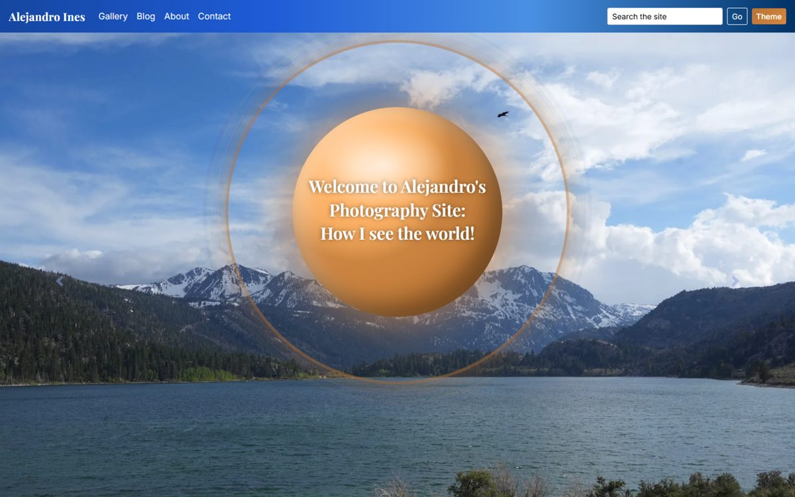
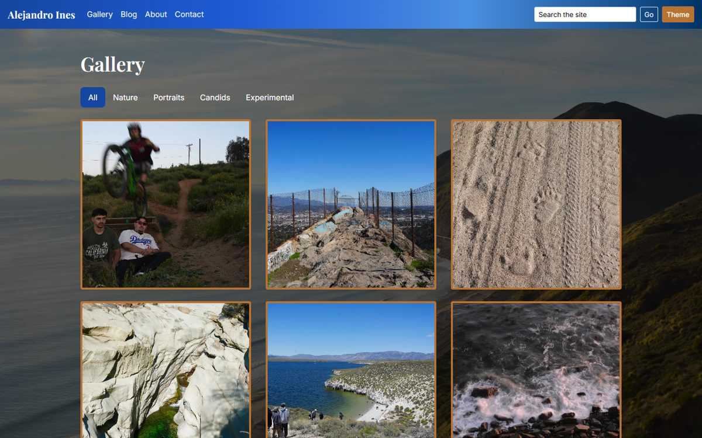

# Alejandro Ines — Photography Portfolio

[](https://github.com/manofmanana/Personal-Photography-Website/actions/workflows/tests.yml)

A full-stack photography portfolio and blog, built with Flask and SQLite as my **CS50x final project**. It showcases photos I've taken in recent years of beautiful places and the people I love (sometimes both at once).

**Live site:** https://aiphotographywebsiteblog.onrender.com/ (hosted on Render's free tier, so the first visit after a quiet spell can take up to a minute to wake up)
**Video demo:** https://youtu.be/QMTZ2I8o7cI




---

## Features

- **Homepage**: a full-screen photo carousel behind a glowing copper sphere, rotating "Food for Thought" quotes, featured work, and a newsletter sign-up.
- **Gallery**: photos tagged *Nature*, *Portraits*, *Candids*, or *Experimental*, with instant client-side filtering (shareable via `?filter=nature`), lazy loading, and hover / tap-to-expand.
- **Blog ("Shutter Speed Soapbox")**: Journal, Note, and Essay posts with an optional photo and a page per post.
- **Search**: finds blog posts by title or text and gallery photos by tag, with matches highlighted.
- **About** and **Contact** pages (the contact form is handled by [Formspree](https://formspree.io)).
- **Light and dark themes** that follow your system setting and remember your choice.
- **Admin panel** (password-protected): publish and delete posts, bulk-upload photos with a tag, retag or delete photos, and export subscribers to CSV.

## How it works

| Piece | Choice | Why |
|---|---|---|
| Backend | Flask | Small, readable, and what CS50 taught |
| Database | SQLite (`database.db`) | One file, no server to run, plenty for one author |
| Frontend | Jinja templates, Bootstrap 4, a little jQuery | Responsive grid without hand-writing one |
| Images | Pillow | Makes web-sized WebP copies of every photo |
| Hosting | Render + Gunicorn | Free tier with auto-deploy from GitHub |

**Web-sized photos.** Camera originals are 2–4 MB each, far too heavy for a grid of 55 photos. The app keeps each original but also writes a WebP copy (max 2000px, EXIF and GPS data removed) under `static/web/`, and templates use the `web_url` filter to serve it. Photos uploaded through the admin panel get their copy automatically; for existing photos, run:

```bash
flask --app app make-web-images
```

This cut the gallery from about 53 MB to 16 MB.

**Security.** The admin password and session key come from environment variables, the password is compared in constant time, every form that posts to the app carries a CSRF token, search terms are escaped before they're highlighted, and SQL queries are parameterized.

**A note on uploads.** Render's free tier wipes its disk on every deploy, so photos uploaded through the live admin panel won't survive a redeploy. Photos are committed to this repo instead. Moving uploads to cloud storage is on the list below.

## Project structure

```
├── app.py               # Routes, database helpers, admin auth, image resizing
├── schema.sql           # Tables: posts, subscribers, gallery
├── database.db          # SQLite database (posts and gallery metadata)
├── templates/           # Jinja templates; base.html is the shared layout
├── static/
│   ├── styles.css       # Copper + navy theme, light/dark modes
│   ├── scripts.js       # Theme toggle, quotes, image fade-in
│   ├── photos/          # Photos used by the page layouts
│   ├── gallery_uploads/ # Gallery photos (originals)
│   ├── uploads/         # Blog post photos (originals)
│   └── web/             # Generated web-sized copies of the above
├── tests/               # pytest suite
├── requirements.txt
└── Procfile             # gunicorn app:app
```

## Running locally

```bash
git clone https://github.com/manofmanana/Personal-Photography-Website.git
cd Personal-Photography-Website

python -m venv .venv
source .venv/bin/activate        # Windows: .venv\Scripts\activate
pip install -r requirements.txt

export ADMIN_PASSWORD=choose-one  # Windows PowerShell: $env:ADMIN_PASSWORD="choose-one"
export SECRET_KEY=any-long-random-string
flask --app app run --debug
```

Then open http://localhost:5000 (admin panel at `/admin/login`).

## Tests

```bash
pip install pytest
pytest
```

The tests run against a temporary copy of the database, so they never change `database.db`. They also run automatically on GitHub Actions for every push and pull request.

## Deployment

Render runs `pip install -r requirements.txt` and starts the app with `gunicorn app:app`. Set two environment variables in the Render dashboard:

- `ADMIN_PASSWORD`: the admin panel password
- `SECRET_KEY`: a long random string (for example, the output of `python -c "import secrets; print(secrets.token_hex(32))"`)

## Future improvements

- Move uploads to cloud storage (e.g. Cloudinary or S3) so they survive redeploys
- Captions and per-photo alt text in the gallery
- A lightbox for viewing gallery photos full size
- Pagination for the gallery and blog
- Editing existing blog posts from the admin panel

## Acknowledgements

- **CS50 staff and community**, for the course and guidance
- **Bootstrap**, **Formspree**, and **Render**
- **AI assistance**: used for scaffolding and debugging (permitted by CS50), and later for a cleanup pass on performance, security, and tests. Final code and design choices are my own.
- **My girlfriend Juliet**, for being so supportive!
